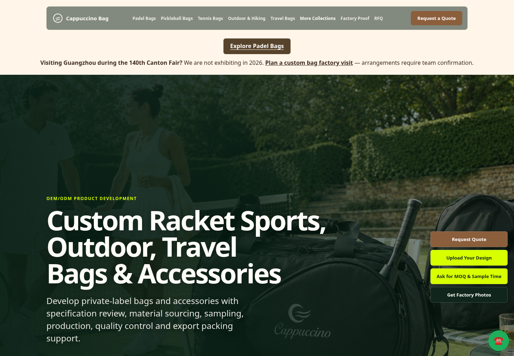
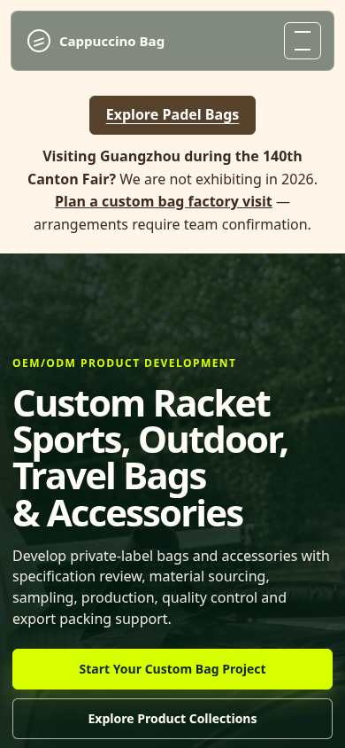
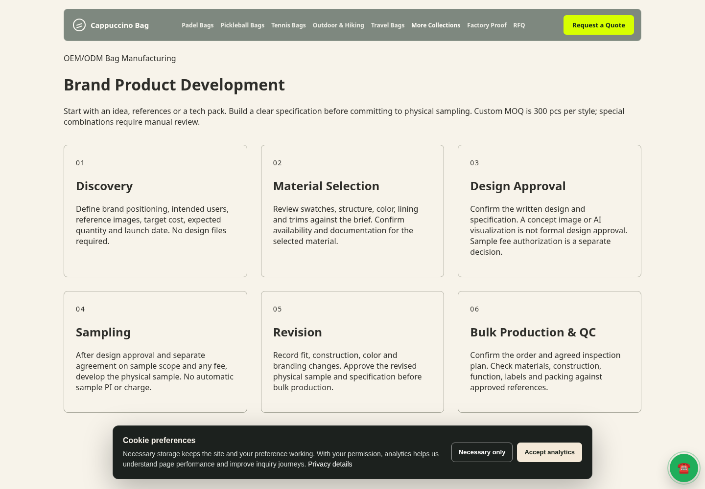
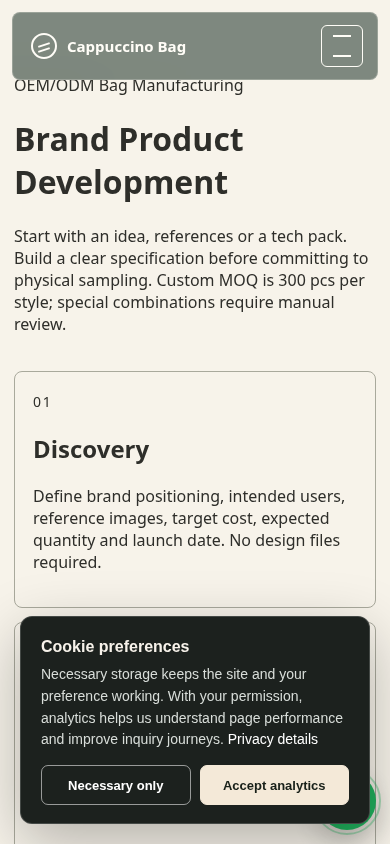

# B2B growth review — 27 October 2026

Review only. No merge or production promotion authorized.

## Incremental audit

Main and production baseline: `97ce3c5cdf7e208d99428d7b68553c9e61138115`. All eight open PRs (#4, #10, #11, #23, #38, #40, #41, #42) were checked using their full changed-file lists. No overlapping file is changed here. Existing product pages, shared submission handler, CRM, API, database and protected configuration remain unchanged.

| Capability | Prior state | Review result |
| --- | --- | --- |
| Broad OEM service | Partial workflow at existing owner | Six stages with separate design and sample-fee approval |
| Three solution entries | Separate existing product owners | Connected anchored sections at the existing OEM owner, footer and llms |
| Padel discovery | Featured grid below first viewport | Category link at y108–152 on 1440×1000 and 390×844; no product reorder |
| Four RFQ routes | Missing customer-type guidance | Dynamic concept, Tech Pack, clubs/events, reorder prompts and conditional fields |
| No-design input | General optional file/message | Positioning, reference upload, material, target cost, quantity and launch date |
| Company OS | Existing canonical ingest | Reused; structured message preserves context without migration |
| SEO/GEO | Existing canonical and owner map | Metadata, SSR explanations, matched visible FAQ schema, internal links and llms |
| Evidence | Existing factory/QC owners | Scoped links; material options and supplier responsibilities explicitly qualified |

## Changed surfaces

- `app/page.js`: compact Padel category discovery link in existing first-screen notice.
- `app/oem-odm-bag-manufacturer/page.js`: same owner, current static loader, additive brief script.
- `public/site/oem-odm-bag-manufacturer/index.html`: connected solutions, workflow, scoped evidence, FAQ and RFQ.
- `public/site/assets/b2b-development.{css,js}`: responsive accessible form styles and dynamic message adapter.
- `lib/site-navigation.js`: separate solution footer group; fixed product/header order preserved.
- `public/llms.txt`: existing owners and Padel-first product discovery retained.
- `tests/b2b-development.test.mjs`: workflow/FAQ, contract, homepage and mocked notification checks.
- This review directory: report and screenshots only.

## Final verification

203 Node tests, ESLint and Next route type generation pass. Normal local build fails because this environment cannot fetch existing Google Fonts imports (HTTP 403). The separate local build using a temporary font-CSS fixture passes 225 pages. The fixture is not committed or configured in Vercel; remote Preview build status is reported in the PR.

Chromium/Playwright checks at 1440×1000 and 390×844 pass: route identity, one canonical, visible FAQ/schema parity, internal links, no horizontal overflow, labels, keyboard focus, contrast, no-JS fallback, required-contact validation, four dynamic paths, no-design message mapping, optional multipart attachment, honeypot, double-click lock, retained values and stable submission ID after mocked 503 then 200. Ten requests were intercepted; zero real inquiries, CRM writes, customer emails, WhatsApp messages or PI/payment actions.

Notification adapter: an injected mock confirms the internal message retains no-design status, launch date and target cost. Default recipient is `info@cappuccinobag.net`, overridable by existing `INQUIRY_TO_EMAIL`. No configuration was read or changed to claim the live override. Missing sender configuration can result in skipped email delivery while an inquiry is saved. Live Company OS persistence and inbox delivery therefore remain **unverified**, not passed. Smallest live check would be one explicitly authorized labelled inquiry, one expected CRM record and one internal inbox notification, followed by reconciliation; it has not been performed.

Local unthrottled performance samples (fallback fonts, external analytics blocked): desktop LCP 504 ms / CLS 0; mobile LCP 712 ms / CLS 0. Document transfer about 14.9 KB and resource transfer about 179 KB. These are local diagnostic observations, not production field metrics, a Lighthouse score or a full accessibility certification.

## Evidence boundaries

Custom MOQ 300 pcs/style; exceptions need manual review. Concept visualization is not design approval. Sample fees need separate agreement after approval. Manufacturing references do not prove every proposed product or order. Hardware and selected accessories may use suppliers; no owned casting/plating/mold facility is claimed. Genuine leather, microfiber, technical and recycled material directions need project-specific sample/composition/document checks. No new customer identities, artwork, prices, volumes, testimonials, certification badges, capacity or performance results are published. Generic hook, base, stabilization, edge and packaging-transfer checks are checkpoints, not case-study outcomes.

## Rollback

Before merge, close the draft PR or discard the review branch. If separately approved and merged later, revert the PR through review. There is no data/schema migration to reverse. Any subsequent deployment is a separate authorized action.

## Screenshots

These show the reviewed layout with local fallback fonts; no customer data appears.

